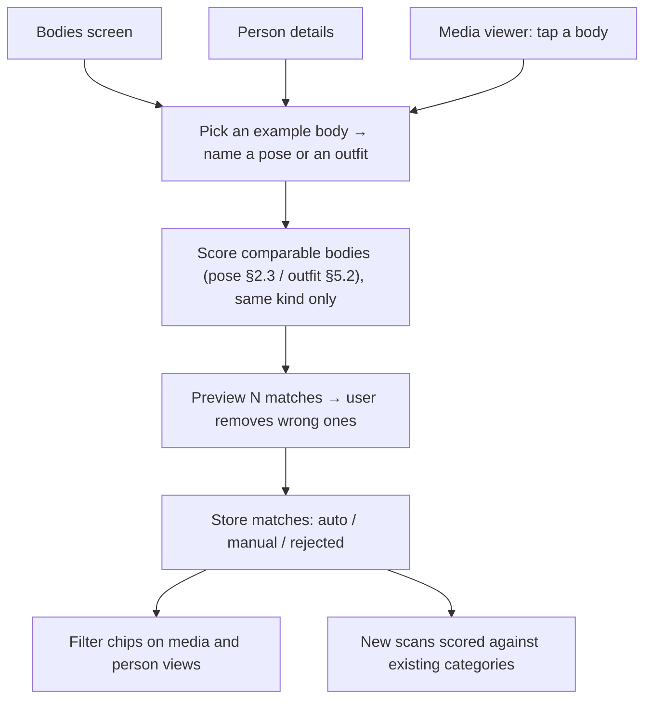
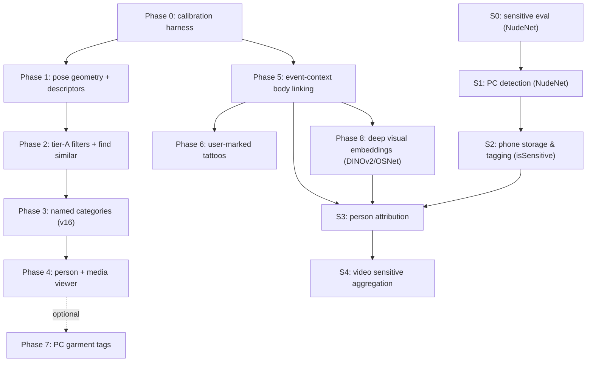

# Body Pose, Clothing, Body Re-Identification & Sensitive Content — Specification & Roadmap
**Document Path:** `docs/body-pose-and-clothing-filters-roadmap.md`
**Date:** 2026-11-01 (revised the same day after a review against the code)
**Status:** Draft — not implemented. Every threshold below is a starting value, to be calibrated in Phase 0.
**Target:** Mobile Flutter app (`mobile/`) first. The PC (`the app/mobile_api/`, `person_linking.py`) is
involved where stated; it stays stateless.

---

## 0. What changed in this revision

The first draft was checked against schema v14, the scan store, the outfit descriptor, grouping and the
installed models. Corrections:

| # | Draft said | Reality / fix |
|---|---|---|
| 1 | Classify directly from `bodies.kpts` | kpts are normalised by width **and** height separately ([photo_result_store.dart](../mobile/lib/domain/scan/photo_result_store.dart) `_kpts`). Angles/distances must be computed after multiplying back by `media.width/height`. |
| 2 | 14 colour bins incl. navy/royal/sky blue, red/burgundy, brown/orange, beige | The 80-float descriptor stores hue×saturation for chromatic pixels and **no brightness**. Shades of one hue are indistinguishable. Only coarse hue families + white/grey/black (§5.1). |
| 3 | "Bhattacharyya distance ≥ 0.84" for same outfit | It is a coefficient (similarity). 0.84 is below the existing same-photo/video thresholds (0.86–0.90); HSV histograms are not reliable across days/lighting (§5.2). |
| 4 | Pose matching by OKS ≥ 0.85 | OKS compares a prediction to ground truth of the same instance. Replaced by a normalised, visibility-masked, mirror-invariant descriptor (§2.3). |
| 5 | Ground contact, jumping, kneeling rules | A single 2D image has no ground plane. Dropped or demoted. |
| 6 | Leg rules on every body | Many bodies are `extent = upper/head`. Every rule is gated by extent and per-keypoint score. |
| 7 | Multi-person interactions from all bodies | Same-outfit faceless bodies (≥ 0.9) in one photo are not stored, max 40 per photo; video detections point at ≤ 3 views per track (§4.0). |
| 8 | Mutual gaze from face yaw | Profile faces often fail the quality gate, so yaw is missing exactly where gaze needs it. |
| 9 | SegFormer / Florence "offline on-device" | They live on the **PC** (`venv_ai`, torch). Using them needs a new endpoint and contract (Phase 7, optional). |
| 10 | Schema | `exemplarBodyId` had no `onDelete`; no outfit-match table; no rejection state; no `kind`; not in backup (§6.4). |
| 11 | Sports/yoga/combat taxonomy as filters | Not reliable from 17 2D keypoints without hand/foot points (§3.5). |
| 12 | Body re-ID: bone ratios as a hard exclusion, moles as a fingerprint, tattoo = 99.9%, silhouette/muscle identity, weighted-sum fusion with auto-link at 0.88 | 2D ratios vary as much within one person as between adults; tattoos repeat and flip in mirror selfies; outlines include clothes. Re-designed as calibrated evidence with context rules, DINOv2 visual embeddings, and exposed body matching (§7.5). |
| 13 | — (added) | Sensitive content & exposed body tracking (§7.5, §8): NudeNet 640m detection, simple boolean tagging (`isSensitive`), no blur/locks; exposed regions serve as biometric identity evidence for linking faceless bodies (§7.5). |

---

## 1. Data foundation (what actually exists)

| Data | Where | Format | Notes |
|---|---|---|---|
| Body keypoints | `bodies.kpts` | JSON `[[x, y, score] ×17]`, x/W and y/H | RTMPose-m body7 on YOLOX-m boxes, PC scan. No hand/foot points. |
| Body extent | `bodies.extent` | `full \| knee \| upper \| head` | Gate for leg/torso rules. |
| Body box | `bodies.bbox*`, `media_detections.x/y/w/h` | normalised | |
| Body crop | `bodies.crop_path` | JPEG, ≤ 512 px tall (`analysis.body_crop`) | Too small for skin detail; marks need the original photo (§7). |
| Outfit descriptor | `bodies.appearance` | 80 × float32 | §5.1. |
| Outline | `media_detections.outline` | flat JSON, normalised to the detection box | Nullable; backfilled on demand. Includes clothing. |
| Head pose | `faces.yaw/pitch/roll` | degrees, InsightFace `landmark_3d_68` | Only for faces that passed the quality gate. Roll used for lying orientation guard (§3.1). |
| Image size / date | `media.width/height`, `media.taken_at` | px / epoch ms, nullable | Size needed for kpts; date for event context (§7). |

**Phone-only:** Phases 0–4 run in Dart over these columns. No new models, downloads or contract change.

**PC:** event-context body linking (Phase 5) extends `person_linking.py`, which stays the single source
of truth for grouping thresholds. Marks matching (Phase 6) uses OpenCV already in the main `venv`.
Garment tags (Phase 7) are optional. Deep visual embeddings (Phase 8) use OSNet x1.0 (512-d, installed) for full-body pedestrian Re-ID and DINOv2 (ViT-S/14, 384-d) for exposed/close-up body patches.

---

## 2. Keypoints, preprocessing and the pose descriptor

### 2.1 COCO 17 keypoints

| Index | Name | Index | Name |
| :-- | :-- | :-- | :-- |
| 0 | nose | 9, 10 | l_wrist, r_wrist |
| 1, 2 | l_eye, r_eye | 11, 12 | l_hip, r_hip |
| 3, 4 | l_ear, r_ear | 13, 14 | l_knee, r_knee |
| 5, 6 | l_shoulder, r_shoulder | 15, 16 | l_ankle, r_ankle |
| 7, 8 | l_elbow, r_elbow | | |

`l_`/`r_` are the **subject's** left/right. In a frontal view `l_` appears on the image right; in a back
view on the image left. Rules never assume a side from image x.

### 2.2 Mandatory preprocessing (`mobile/lib/domain/pose/pose_geometry.dart`)

1. **Denormalise:** `px = x · media.width`, `py = y · media.height`. Skip bodies with no media size.
2. **Visibility:** a keypoint is usable when `score ≥ 0.3` (same as `person_linking.KPT_VISIBLE`).
   Joint angles need all three points usable.
3. **Extent gate:** leg rules require `extent ∈ {full, knee}` and the needed points visible; ankle rules
   require `full`.
4. **Scale:** `torso = |M(5,6) − M(11,12)|`. Without hips, `shoulder_width` is a weaker fallback and
   torso-based rules are skipped.
5. **Image axes:** y grows downward. "Above" means smaller y.
6. **Spine tilt:** `φ = atan2(|Δx|, |Δy|)` of hip-mid → shoulder-mid; 0° = upright.

Helpers: `angle(A, B, C)` (flexion at B), `mid(A, B)`, `dist(A, B)`.

### 2.3 Pose similarity descriptor (replaces OKS)

1. Translate so `M(11,12)` (or `M(5,6)` when hips are missing) is the origin.
2. Anthropometric scale factor: `scale = torso_length = |M(5,6) − M(11,12)|` when hips are visible; when hips are missing or occluded, use the anthropometrically calibrated compensation `scale = shoulder_width * 1.35` (matching average human adult torso-to-shoulder ratio).
3. Keep 17 × (x, y) plus a 17-bit visibility mask → 34 floats + mask.
4. **Mirror:** also build the left↔right flipped version (swap pairs, negate x).
5. **Distance:** mean Euclidean distance over keypoints visible in both, weighted by the min of the two
   scores; require ≥ 8 shared visible points, else "not comparable". Similarity =
   `max(sim(a, b), sim(a, mirror(b)))`, `sim = exp(−d² / 2s²)`.
6. `s` and the match threshold come from Phase 0 — no fixed 0.85.
7. Rotation alignment (2D Procrustes) is **off**: standing vs lying must stay different.

Cached in `body_pose_features` (§6.4) so searches never re-parse JSON.

---

## 3. Single-person pose taxonomy

- **A — filter:** filter chip; expected usable after Phase 0.
- **B — suggestion only:** inside "find similar" or as an unconfirmed hint; never a filter.
- **C — not supported:** not separable from 17 2D keypoints in one photo. Users can still make any of
  these a **named pose from an example** (§6).

### 3.1 Basic postures (الأوضاع الأساسية)

| Pose | Tier | Rule (after §2.2) |
|---|---|---|
| **Lying (نايم / مستلقي)** | A | `φ > 60°` with shoulders and hips visible. **Orientation Guard:** To prevent misclassifying sideways photos of standing people (missing EXIF orientation) as Lying: if the body's keypoints satisfy the **Standing** rule (§3.1) after a 90° coordinate rotation, flag as a rotated standing photo and exclude from Lying. A genuine lying posture is confirmed if the limbs/joints are relaxed/bent (does not satisfy rotated Standing), or if the face is upright relative to the frame (`\|faces.roll\| < 35°`, resting head). |
| **Standing (واقف)** | A | `φ < 25°`, both knees `> 155°`, `hip.y < knee.y < ankle.y`, thigh not foreshortened: `|hip−knee| ≥ 0.7 · |knee−ankle|`. Needs `extent = full`. |
| **Sitting (قاعد)** | A | `φ < 35°` and either (a) side-ish: knee in `[70°, 135°]`, `|hip.y − knee.y| < 0.35 · torso`; or (b) frontal: thigh foreshortened `|hip−knee| < 0.6 · |knee−ankle|`, knee below hip. A frontal sitter's 2D knee angle is near 180°, which the draft missed. |
| Squatting (قرفصاء) | B | Knee `< 70°`, `|hip.y − ankle.y| < 0.5 · torso`. Confused with sitting low. |
| Bending over (موطي) | B | Knees `> 140°`, `angle(shoulder, hip, knee) < 110°`, `φ > 30°`. |
| Kneeling, all-fours | C | Need ground contact. |

Draft sub-categories (contrapposto, cross-legged, chair vs floor, side vs back lying) are C.

### 3.2 Arms (حركات الأذرع)

| Pose | Tier | Rule |
|---|---|---|
| **Both arms raised** | A | Both wrists above their shoulders by `> 0.25 · torso`. |
| **One arm raised** | A | One wrist above its shoulder by `> 0.25 · torso`, the other below. |
| **Arms spread / T-pose** | A | Both wrists within `0.25 · torso` of shoulder height, elbows `> 150°`, wrist span `> 2.2 · shoulder_width`. |
| **Hands on hips** | A | Each wrist within `0.3 · torso` of its own hip, elbows `< 120°`, each elbow farther from the body midline than its shoulder (distances, not image-x signs). |
| Arms crossed | B | Both wrists between shoulder and hip lines, each closer to the **opposite** shoulder. |
| Hand to face | B | A wrist inside the face box grown by 30% (linked face, else points 0–4). |
| Hands in pockets / behind back, selfie arm | C | "Wrist not visible" equals a cropped photo; foreshortening is unmeasurable in 2D. |

### 3.3 Motion (الحركة)

| Pose | Tier | Rule |
|---|---|---|
| Stride (walking/running) | B | Ankle spread `> 0.5 · leg_length`, upright torso; running adds one knee `< 110°`. |
| Wide stance | B | Ankle spread `> 1.5 · hip_width`, knees `> 150°`. |
| Jumping, push-up/plank, lunge, splits, bridge | C | Need ground plane or depth. |

### 3.4 Orientation (اتجاه الجسم)

| Pose | Tier | Rule |
|---|---|---|
| **Frontal** | A | Both eyes and ears visible, or linked face `|yaw| < 25°`; shoulder span `≥ 0.6 · torso`. |
| **Profile** | A | Linked face `|yaw| > 60°`, or exactly one ear visible with shoulder span `< 0.35 · torso`. |
| **Back view** | A | Points 0, 1, 2 all `score < 0.2`, both shoulders visible, no linked face. |
| Three-quarter, looking over the shoulder | B | Between frontal/profile; back/profile torso with linked face `|yaw| < 30°`. |
| Low/high camera angle | C | Needs a camera model. |

### 3.5 Not supported as rules: sports, gym, yoga, combat

Deadlift, overhead press, pull-up, dips, plank, curls, lateral raise, downward dog, cobra, warrior I–III,
tree, handstand, child's pose, boxing guard, punch, kicks, knee strike, ball-sport actions, sprinter
start, goalkeeper dive, cycling, skate/surf stance — they depend on hands/feet, equipment, ground
contact or depth. Available only as named poses from an example.

---

## 4. Multi-person poses

### 4.0 Data limits

- Faceless bodies whose outfit matches another faceless body in the same photo (≥ 0.9) are not stored,
  max 40 faceless bodies per photo. A team in identical uniforms is mostly missing.
- In videos a detection can point at one of ≤ 3 representative views of the track
  ([video_tracks.dart](../mobile/lib/domain/scan/video_tracks.dart)), whose kpts come from another frame.
  **Multi-person rules run on photos only.**
- Top-down pose estimation on overlapping people swaps/merges limbs or loses one box.
- Face yaw exists only for stored faces.

### 4.1 Tiers

| Interaction | Tier | Rule |
|---|---|---|
| **Group photo** | A | `≥ 3` bodies. |
| **Side-by-side lineup** | A | `≥ 2` bodies, shoulder-mid y within `0.3 · median torso`, box overlap `≤ 30%`. |
| **All facing camera** | A | Every body has a linked face with `|yaw| < 20°`. Hidden when any body lacks a face. |
| Arm around shoulder | B | Wrist of A within `0.3 · torso_B` of a shoulder of B, side by side. |
| Hug | B | Torso boxes IoU `> 0.3`, a wrist of one inside the other's torso box. |
| Holding hands | B | Wrists of A and B within `0.2 · mean torso`, between them, below shoulders. |
| Mirrored poses | B | §2.3 similarity above the named-pose threshold. |
| Looking at each other | B | Both linked faces, yaw pointing at each other, `|yaw| > 30°`. Verify yaw sign first. |
| Tiered family photo | B | Some Sitting, others Standing with higher shoulders. |
| Waist, linked arms, head on shoulder, whispering, high-five, fist bump, group jump, carrying, piggyback, shoulder ride, bridal carry, huddle, VIP | C | Need depth, ground plane or reliable limbs in overlap. |

---

## 5. Clothing & appearance

### 5.1 Tier 1 — existing 80-float descriptor (phone, free)

From [person_linking.py](../the%20app/person_linking.py) `appearance_descriptor`: torso and legs regions
(from keypoints, else box fractions), 40 floats each, weighted 0.6 / 0.4. Chromatic pixels
(`S ≥ 50`, `V ≥ 40`) → 12 hue × 3 saturation bins; achromatic → 4 value bins. Square root of the
normalised histogram, so dot product = Bhattacharyya coefficient. Brightness of chromatic pixels is
**not recorded**.

| Filter | Possible? |
|---|---|
| White / light grey / dark grey / black | ✅ |
| Hue families: red, orange/brown, yellow/beige, green, cyan, blue, purple, pink | ✅ coarse — orange vs brown, yellow vs beige, red vs burgundy, navy vs sky blue **not** separable |
| Colourful vs neutral, monochrome (torso ≈ legs), contrasting | ✅ |
| Charcoal, navy, royal/sky blue, burgundy, olive vs forest green as names | ❌ |

Labels read "mostly blue", not "navy". Hue boundaries (OpenCV 0–180, 15° bins) are set in Phase 0.
A descriptor v2 with brightness bins would allow shades but needs PC + phone changes and a rescan —
separate decision.

### 5.2 Outfit similarity

- Uses the existing `appearanceSimilarity` (`scan_math.dart`).
- Across days, lighting shifts histograms and many dark outfits look alike. The UI says **"similar
  colours"** and ranks; named-outfit threshold starts at 0.90, calibrated in Phase 0.
- Bodies whose regions are all zeros never match.

### 5.3 Exposed upper body

The draft's face-to-torso skin rule cannot be computed from the descriptor (no face region, no
brightness). Phone: a named outfit can be "lower only" (legs region only). PC, Phase 7: SegFormer
upper-clothes vs skin areas, stored on the phone as a flag.

### 5.4 Tier 2 — garment tags from the PC (optional Phase 7)

Target vocabulary: **upper** t-shirt, shirt, polo, hoodie, jacket/blazer, tank top, crop top, sweater,
jersey, blouse; **lower** jeans, trousers, shorts, sweatpants, skirt, leggings; **full body** suit,
dress, abaya/thobe/kaftan, jumpsuit, tracksuit, swimsuit, swim trunks; **outerwear** leather/denim
jacket, coat, puffer; **patterns** plain, striped, plaid, floral, printed; **accessories** cap/hat,
beanie, hood up, sunglasses, glasses, tie, scarf, bag; **footwear** sneakers, boots, heels, sandals,
barefoot.

| Source | Runs in | Gives | Caveat |
|---|---|---|---|
| WD14 tagger | main `venv`, ONNX | multi-label tags | anime-trained; per-tag precision on real photos measured first |
| SegFormer clothes (ATR) | `venv_ai` | garment/skin regions | slow worker; region type, not style |
| Florence-2 | `venv_ai` | captions | not used for filters (gets details wrong) |

Style labels (formal, streetwear…) and fabrics are not planned.

---

## 6. User-driven categories and screens

Users build categories from examples (query-by-example). This works for any pose or outfit, including
everything marked C, without a hand-written rule.



### 6.1 Bodies screen (`mobile/lib/features/bodies/bodies_screen.dart`)

- Grid of body crops, optional skeleton overlay (reuse the joint drawing in `media_screen.dart`).
- Tabs `All | Poses | Outfits`; Tier-A pose chips and colour chips as filters.
- Select → **Name pose** / **Name outfit** → preview with remove-before-save; removed ones are stored
  as `rejected`.
- Route in `mobile/lib/core/router.dart`. Scoped by `kind`; characters are not mixed with people.

### 6.2 Person details (`person_detail_screen.dart`)

Poses/Outfits chips from that person's bodies; tap → that person's photos filtered. A named outfit can
be person-scoped or global.

### 6.3 Media viewer (`media_screen.dart`)

Tap a body → **Find similar pose**, **Find similar colours**, **Name pose**, **Name outfit**,
**Mark a tattoo** (§7.4). Video frames use the linked body row, which may be another frame's view —
the sheet says "from this clip".

### 6.4 Schema (v16, `mobile/lib/data/db/tables.dart`)

*(Note: Schema v15 was assigned to `kind_overrides`. Pose, outfit, body marks, and body clustering tables bump the schema to **v16**).*

```dart
/// Additions to existing Bodies table:
// // 1. Full-body pedestrian Re-ID (OSNet x1.0, 512-d):
// BlobColumn get reidEmbedding => blob().nullable()(); // 512 x float32 (OSNet x1.0)
// @ReferenceName('reidClusterBodies')
// IntColumn get reidClusterId => integer().nullable().references(BodyClusters, #id, onDelete: KeyAction.setNull)();
//
// // 2. Exposed Upper Body / Chest (§7.5, DINOv2 ViT-S/14, 384-d):
// @ReferenceName('chestClusterBodies')
// IntColumn get chestClusterId => integer().nullable().references(BodyClusters, #id, onDelete: KeyAction.setNull)();
// BlobColumn get chestEmbedding => blob().nullable()(); // 384 x float32 (DINOv2)
//
// // 3. Exposed Lower Body / Buttocks (§7.5, DINOv2 ViT-S/14, 384-d):
// @ReferenceName('buttocksClusterBodies')
// IntColumn get buttocksClusterId => integer().nullable().references(BodyClusters, #id, onDelete: KeyAction.setNull)();
// BlobColumn get buttocksEmbedding => blob().nullable()(); // 384 x float32 (DINOv2)
//
// // 4. Morphological metrics, skin tone, and micro-marks JSON:
// TextColumn get morphology => text().nullable()(); // JSON: {scale_source, breast_span_ratio, areola_contrast, hip_waist_ratio, buttocks_span_ratio, skin_tone_lab, micro_marks}

/// Clustered faceless / exposed body groups (§7.5)
@TableIndex(name: 'body_clusters_person', columns: {#personId})
@DataClassName('BodyClusterRow')
class BodyClusters extends Table {
  IntColumn get id => integer().autoIncrement()();
  TextColumn get kind => text().withDefault(const Constant('person'))();
  IntColumn get personId => integer().nullable().references(
    Persons, #id, onDelete: KeyAction.cascade)();
  TextColumn get clusterType => text()(); // 'chest' | 'buttocks' | 'full_body'
  BlobColumn get centroidEmbedding => blob()(); // 384 x float32 (DINOv2) or 512 x float32 (OSNet)
  IntColumn get bodyCount => integer().withDefault(const Constant(0))();
  IntColumn get createdAt => integer()();
}

/// User-marked distinctive marks and tattoos (§7.4)
@TableIndex(name: 'body_marks_person', columns: {#personId})
@DataClassName('BodyMarkRow')
class BodyMarks extends Table {
  IntColumn get id => integer().autoIncrement()();
  IntColumn get personId =>
      integer().references(Persons, #id, onDelete: KeyAction.cascade)();
  IntColumn get sourceBodyId => integer().nullable().references(
    Bodies, #id, onDelete: KeyAction.setNull)();
  TextColumn get segment => text()(); // e.g. 'r_forearm', 'chest', 'ribs', 'upper_back'
  TextColumn get anchor => text()(); // JSON: patch box relative to segment keypoints
  TextColumn get patchPath => text()(); // relative, 'marks/<id>.jpg' — included in backup
  TextColumn get label => text().nullable()();
  IntColumn get createdAt => integer()();
}

/// Cached pose descriptor, rebuilt when version or the body's kpts change. Not backed up.
@DataClassName('BodyPoseFeatureRow')
class BodyPoseFeatures extends Table {
  IntColumn get bodyId =>
      integer().references(Bodies, #id, onDelete: KeyAction.cascade)();
  IntColumn get version => integer()();
  BlobColumn get feature => blob()(); // 34 x float32, normalised (§2.3)
  IntColumn get visibleMask => integer()(); // 17 bits
  TextColumn get tags => text().withDefault(const Constant(''))(); // tier-A labels
  @override
  Set<Column> get primaryKey => {bodyId};
}

@DataClassName('PoseCategoryRow')
class PoseCategories extends Table {
  IntColumn get id => integer().autoIncrement()();
  TextColumn get name => text().withLength(min: 1, max: 80)();
  TextColumn get kind => text().withDefault(const Constant('person'))();
  IntColumn get exemplarBodyId => integer().nullable().references(
    Bodies, #id, onDelete: KeyAction.setNull)();
  BlobColumn get exemplarFeature => blob()(); // copy, survives body deletion
  IntColumn get exemplarMask => integer()();
  RealColumn get threshold => real()();
  IntColumn get createdAt => integer()();
}

@DataClassName('OutfitCategoryRow')
class OutfitCategories extends Table {
  IntColumn get id => integer().autoIncrement()();
  TextColumn get name => text().withLength(min: 1, max: 80)();
  TextColumn get kind => text().withDefault(const Constant('person'))();
  IntColumn get personId => integer().nullable().references(
    Persons, #id, onDelete: KeyAction.cascade)();
  IntColumn get exemplarBodyId => integer().nullable().references(
    Bodies, #id, onDelete: KeyAction.setNull)();
  BlobColumn get exemplarAppearance => blob()(); // 80 x float32 copy
  BoolColumn get lowerOnly => boolean().withDefault(const Constant(false))();
  RealColumn get threshold => real()();
  IntColumn get createdAt => integer()();
}

/// state: 'auto' | 'manual' | 'rejected' (user removed — never re-added)
@TableIndex(name: 'body_pose_matches_cat', columns: {#categoryId})
@DataClassName('BodyPoseMatchRow')
class BodyPoseMatches extends Table {
  IntColumn get bodyId =>
      integer().references(Bodies, #id, onDelete: KeyAction.cascade)();
  IntColumn get categoryId =>
      integer().references(PoseCategories, #id, onDelete: KeyAction.cascade)();
  RealColumn get similarity => real()();
  TextColumn get state => text()();
  @override
  Set<Column> get primaryKey => {bodyId, categoryId};
}

@TableIndex(name: 'body_outfit_matches_cat', columns: {#categoryId})
@DataClassName('BodyOutfitMatchRow')
class BodyOutfitMatches extends Table {
  IntColumn get bodyId =>
      integer().references(Bodies, #id, onDelete: KeyAction.cascade)();
  IntColumn get categoryId =>
      integer().references(OutfitCategories, #id, onDelete: KeyAction.cascade)();
  RealColumn get similarity => real()();
  TextColumn get state => text()();
  @override
  Set<Column> get primaryKey => {bodyId, categoryId};
}
```

- Idempotent migration v15 → v16 in `app_database.dart` (v15 is `kind_overrides`).
- Persistent tables (`body_clusters`, `body_marks`, `pose_categories`, `outfit_categories`, `body_pose_matches`, `body_outfit_matches`) go into `backupTables` in
  [backup_service.dart](../mobile/lib/domain/backup/backup_service.dart) after `bodies`;
  `body_pose_features` is a cache, rebuilt after restore. A v15 backup restores cleanly.
- **Bridge Photo Representation:** Because `Bodies` maintains both `chestClusterId` and `buttocksClusterId`, a single body photograph displaying both upper and lower exposed anatomy simultaneously links to its chest cluster and buttocks cluster. When either cluster is assigned to a person, the bridge photo propagates attribution across both clusters automatically.

### 6.5 Mandatory In-Place Update Rule (Rescan Safety)

During library rescans, version migrations, or sensitive backfills, executing `DELETE FROM bodies WHERE media_id = ?` is **strictly forbidden**:
- **Preservation Invariant:** Rescan and re-detection workers must match freshly detected body boxes against existing `Bodies` rows using spatial overlap (`IoU ≥ 0.50`).
- **In-Place Mutation:** Attributes (`kpts`, `extent`, `appearance`, `reidEmbedding`, `chestEmbedding`, `buttocksEmbedding`, `reidClusterId`, `chestClusterId`, `buttocksClusterId`, `morphology`) must be updated in-place via `UPDATE bodies SET ... WHERE id = existing.id`.
- **Relational Integrity:** This guarantees that the primary key `bodies.id` never changes across rescans, preventing accidental cascade deletion of child records in `media_detections`, `body_pose_matches`, `body_outfit_matches`, `body_marks`, and preserving manual assignments (`personId`), user links (`linkMethod`), and user corrections. Only genuinely obsolete bodies (no detection match) may be removed.

---

## 7. Face-independent identity (body re-identification)
*(التعرف على الشخص من غير وشه)*

### 7.0 Principles

1. **No body cue is proof.** Each cue gives evidence with a weight measured on the user's own curated
   library. Claims like "99.9%" or "permanent fingerprint" are removed.
2. **Context decides what may be automatic.** Body evidence auto-links only inside the same photo/video
   (existing behaviour) or the same event (§7.2). Across events it is always a Quick Review suggestion.
3. **Thresholds live in `person_linking.py`** (single source of truth, reached through
   `POST /v1/grouping/plan`). The phone sends evidence; the PC returns links; the phone applies them.
4. **Corrections stick:** a "No" writes `body_rejections` (already sent to grouping); the same body is
   never suggested for that person again.
5. **Privacy:** body descriptors and mark patches are biometric data. They stay on the phone like face
   embeddings, travel only inside `.agbackup`, and the PC keeps nothing after a request.
6. **Exposed body matching authorized:** Exposed body regions (§7.5) are explicitly authorized as biometric
   and visual identity evidence for linking and clustering faceless bodies. Sensitive content tagging (§8)
   and body identity are complementary: NudeNet localizes exposed regions, and §7.5 matches their visual
   embeddings, anatomical morphology, and skin characteristics to link photos to the correct person profile.

### 7.1 Evidence review — the draft's four layers and what replaces them

| Cue | Draft | Verdict | Why |
|---|---|---|---|
| Face embedding | — | ✅ existing, strongest | |
| Weak face on the body | — | ✅ existing (`weak_face`) | |
| Same outfit, same photo/video | — | ✅ existing (`appearance`) | |
| **Same outfit, same event** | missing | ✅ **new, Phase 5 — biggest win** | A beach day: the face shows in some photos, the back in others, the swimsuit is the same. Cheap: `taken_at` + existing descriptor. |
| **Tattoo** | auto-detect + 99.9% auto-link | ⚠️ **user-marked, suggestion first** (Phase 6) | Strong when it matches, but popular designs repeat, mirror selfies flip the side, perspective and skin stretch distort it, and auto-detection confuses clothing prints, shadows and jewellery. |
| Moles / beauty marks | "permanent fingerprint" | ⚠️ **secondary confirmatory boost** (Phase 8 / §7.5) | Extracted on PC during scan of the 2560 px photo via Laplacian of Gaussian (LoG) on segmented bare skin, saved as relative coordinates `micro_marks` in `Bodies.morphology`. Not a mandatory sole anchor due to varied lighting/resolution, but provides a high-confidence confirmatory boost to candidate clusters. |
| Scars / birthmarks | reflectance texture | ❌ dropped | Rarely visible at gallery resolution; lighting-dependent. |
| Bone ratios | "constant", hard exclusion | ⚠️ **soft veto only** (Phase 5) | 2D ratios change with camera angle, pose, perspective and keypoint error; clothes shift shoulder/hip points. Variation within one person is similar to the difference between adults. Used only when both bodies are frontal, upright, `extent = full`, and the difference is far beyond the calibrated spread. Never a positive signal. |
| Silhouette / muscle build | Fourier/Hu shape identity | ❌ dropped as identity | The RMBG outline includes clothes and hair and changes with pose; weight changes over time. |
| Deep visual embeddings (DINOv2 & OSNet) | 8 MB, "identifies from body and movement" | ✅ **Phase 8 / §7.5** | **OSNet x1.0 (512-d):** installed at `the app/models/reid/osnet_x1_0.onnx`, used for full-body pedestrian Re-ID (`Bodies.reidEmbedding`). **DINOv2 ViT-S/14 (384-d):** at `the app/models/reid/dinov2_vits14.onnx`, used for exposed upper/lower body patches (`Bodies.chestEmbedding` and `Bodies.buttocksEmbedding`) to eliminate pedestrian domain shift. |
| Time proximity | weight `w5` | ✅ folded into the event rule | |

### 7.2 Event-context linking (Phase 5)

A faceless body `b` may link to person `P` when:

1. An **anchor**: a body of `P` linked through a face (face or `weak_face` auto, or manual) in another
   media item.
2. **Same event:** `|taken_at(b) − taken_at(anchor)| ≤ 6 h` (starting value). Media without `taken_at`
   are excluded from this rule.
3. **Same outfit:** `appearance_similarity ≥ event_auto` against the best anchor, with a margin over the
   best anchor of any other person in the window (same rule shape as the existing `body_auto` /
   `body_margin`). The comparison uses the current 80-float `bodies.appearance` for clothed bodies. When
   NudeNet detects torso nudity (`exposed_breast` or `exposed_belly`), outfit matching is marked "not
   applicable" and routes directly to §7.5 exposed body matching.
4. **Not contradicted:** `P` not in `b`'s rejections; `P` not already in `b`'s frame; bone-ratio veto
   (§7.1) not triggered; no other person in the window with a near-equal outfit (two people in the same
   uniform → suggestion only).

Decision: above `event_auto` with margin → `auto`; above `event_suggest` → `suggest`. Starting values
`event_auto = 0.90`, `event_suggest = 0.82`, tuned in Phase 0 to precision ≥ 0.98 (auto) and ≥ 0.85
(suggest). New `method = 'event_outfit'`.

Contract change: each body in the grouping request gains `taken_at` (nullable); `BodyLink.method` gains
`event_outfit`. `link_faceless_bodies` gets the rule; `grouping_core` fixtures are regenerated and
`test_grouping_core.py` extended. Phone: `_derivedLinks` in
[grouping_inputs.dart](../mobile/lib/domain/grouping/grouping_inputs.dart) and `review_body_links.method`
accept the new value.

### 7.3 Fusion (replaces the weighted sum)

The draft added raw scores of different kinds with fixed weights and thresholds (0.88 / 0.65–0.87).
Instead, per cue `c`:

- Phase 0 measures the score distributions for same-person and different-person body pairs on the
  curated library and stores a **log-likelihood ratio** table `LLR_c(score)`, capped per cue.
- `evidence = Σ LLR_c` over available cues (cues treated as independent — the cap limits the damage
  when they are not, e.g. outfit and re-ID both reacting to clothes, so these two are combined as
  `max`, not sum).
- Hard constraints (frame co-occurrence, rejections, `distinct_from`, bone-ratio veto) override.
- Auto requires same photo/video or same event **and** `evidence ≥ auto_level` **and** a margin over the
  runner-up person. Otherwise `suggest` if `evidence ≥ suggest_level`.
- Levels are chosen from Phase 0 for the precision targets above. Tables live in `person_linking.py`.

### 7.4 User-marked tattoos (Phase 6)

1. **Marking:** in the media viewer, on a body of a known person (face visible), the user draws a box
   around a tattoo and picks the body segment. The phone stores the patch cut from the **original photo**
   (not the 512 px crop) and its position relative to the segment's canonical two anchor points:
   - **Limbs:** standard joint pair (e.g. `r_forearm` = `8→10`, `l_upper_arm` = `5→7`, `r_lower_leg` = `14→16`).
   - **Torso areas (`chest`, `abdomen`, `ribs`, `upper_back`, `lower_back`):** anchored to the spine axis `M(5,6) → M(11,12)` (shoulder midpoint to hip midpoint), or `5 → 6` (shoulder span) when hips are outside the frame.
   - **Pelvis (`hips`):** anchored to `11 → 12` (`l_hip → r_hip`).
2. **Candidates:** faceless bodies with that segment's anchor keypoints visible (all required keypoints `≥ 0.3`),
   first in the person's events, then library-wide. The phone cuts the matching region from each candidate photo.
3. **Matching (PC, stateless):** `POST /v1/analyze/marks` — reference patch + candidate patches →
   OpenCV AKAZE/ORB features + RANSAC homography → inlier count and inlier ratio. Each candidate is also
   tried **mirrored and on the opposite segment** (mirror selfies). Only OpenCV from the main `venv`;
   no models, no downloads; nothing stored. Optional upgrade after download approval: DISK or ALIKED
   features + LightGlue (ONNX), more robust to skin stretch and lighting; same endpoint, same output.
   Tattoos on any visible body segment (arms, shoulders, chest, abdomen, ribs, upper/lower back, hips, and
   legs) are fully supported. When a tattoo is located on or near an exposed sensitive region, it serves
   as a powerful persistent biometric identifier for §7.5 exposed body matching, rather than being rejected.
4. **Use:** inlier counts feed `LLR_mark` (§7.3). Until Phase 0 shows precision, a tattoo match alone is
   only a **suggestion**; with event context or outfit it can reach auto.
5. **Automatic tattoo discovery** (without user marking) is not planned.

Schema definition: Table `BodyMarks` is integrated into Drift Schema v16 (§6.4) and included in `backupTables` along with `marks/` cut patches.

### 7.5 Exposed Body Region Matching (Upper & Lower Body Re-ID)
*(مطابقة الأجسام العارية للجزء العلوي والسفلي)*

When photos lack faces (cropped or headless framing) but contain exposed upper or lower body regions, the system
performs direct biometric and visual matching on the exposed regions to link them together:

1. **Upper Body Matching (Chest / Torso):**
   - **Trigger:** NudeNet detects `exposed_breast` or `exposed_belly`.
   - **Patch Visual Embedding (DINOv2 ViT-S/14, 384-d):** Unified deep visual feature vector extracted from the chest/torso crop (capturing muscle definition, shading, anatomical fullness, and skin characteristics without pedestrian domain bias).
   - **Extractable Morphological Descriptors (Replacing unextractable fine landmarks):**
     - *Relative breast box span:* Horizontal span of NudeNet breast boxes normalized by RTMPose shoulder width `|M(5,6)|` (`breast_span / shoulder_width`).
     - *Areola pigmentation contrast:* Local adaptive thresholding / Otsu binarization within the detected NudeNet breast box to compute contrast ratio between areolar pigmentation and surrounding skin.
     - *Torso contour:* RMBG 1.4 silhouette matting isolating lateral torso contours and cleavage curvature.
   - **Micro-landmarks & Moles (PC Scan-Time Extraction):** During the standard scan of the 2560 px photo, the PC runs Laplacian of Gaussian (LoG) blob detection on the segmented RMBG bare-skin chest area, computing coordinates relative to the clavicle-hip skeleton and saving them in `Bodies.morphology` JSON. The phone-local clustering isolate matches mark constellations using spatial tolerance ($\epsilon \le 0.05$ torso scale) as a high-confidence confirmatory boost.
   - **Skin Chromaticity Profile:** Perceptually uniform $L^*a^*b^*$ tone histogram on bare skin, filtering out mismatched skin phototypes.

2. **Lower Body Matching (Buttocks / Genitalia / Thighs):**
   - **Trigger:** NudeNet detects `exposed_buttocks`, `exposed_genitalia`, or exposed lower torso/thighs.
   - **Patch Visual Embedding (DINOv2 ViT-S/14, 384-d):** 384-d embedding vector for buttocks/pelvis patches.
   - **Extractable Morphological Descriptors:**
     - *Hip-to-Waist / Hip-to-Thigh Ratio:* Measured from RTMPose hip keypoints `|M(11, 12)|` normalized by RMBG lateral waist and thigh contours.
     - *Relative Buttocks Span:* Width of NudeNet `exposed_buttocks` bounding box normalized by hip width `|M(11, 12)|` (`buttocks_span / hip_width`).
   - **Skin Chromaticity Profile:** Perceptually uniform $L^*a^*b^*$ tone histogram on bare lower body skin.
   - **Close-Up Fallback (Missing Keypoints):** When close-up framing omits visible shoulder `M(5,6)` or hip `M(11,12)` keypoints (`score < 0.3`), span ratios and `micro_marks` coordinates are normalized by the body bounding box width (`body.w`) instead, and `morphology.scale_source` is set to `'bbox'` (instead of `'kpts'`). The phone matcher compares ratios only between bodies sharing the same `scale_source`.

3. **Clustering & Person Attribution (100% Phone-Local):**
   - **Phone-Side Isolate Execution:** Clustering (DBSCAN / Agglomerative) is executed **100% locally on the phone in a dedicated Dart isolate** using SIMD `Float32List` operations (<20 ms for 100 bodies). Zero server transfer, fully offline and private.
   - **Cross-Photo Similarity Matrix:** Pairwise Cosine similarity across visual embeddings (`chestEmbedding` / `buttocksEmbedding`) and morphological metrics from `morphology` JSON.
   - **Persistent Body Clusters:** Discovered clusters are stored in the SQLite table `BodyClusters` (§6.4) with their centroid embedding.
   - **Bridge Photos (Multi-Cluster Representation):** A body photograph displaying both upper and lower exposed regions carries both `chestClusterId` (e.g. Cluster 3) and `buttocksClusterId` (e.g. Cluster 8) in `Bodies` (Schema v16). When either cluster is assigned to a person, the bridge photo propagates attribution across both clusters automatically.
   - **One-Tap Assignment:** Displayed in the Bodies Screen (`/bodies`) or Quick Review, allowing the user to confirm the whole cluster to a Person with a single tap.

### 7.6 Quick Review card

- Shows the candidate body **next to the anchor** (the photo with the face or confirmed body cluster) and the reasons as chips:
  "same chest morphology · 91% similarity", "mole match · upper chest", "same outfit · same day 14:02", "tattoo match · right forearm".
- **Yes** links only this body, or offers "Also link N similar bodies in this cluster?" with a preview.
- **No** writes `body_rejections`. **Not sure** uses snooze.

### 7.7 Not planned

Silhouette-only identity from loose clothing, gait analysis, and automatic tattoo discovery without anchor points.

---

## 8. Sensitive content: detection, attribution, and tagging
*(كشف المحتوى الحساس، ربطه بالشخص، ووضع العلامات)*

Goal: after a scan, identify photos containing exposed or sensitive body parts, where they are, and which
person they belong to (through the §7 cues, including §7.5 exposed body matching). Enables straightforward internal tagging (`isSensitive`)
so the user can locate or query sensitive items if desired, without any complex protection or lock layers.
*Per user instructions, all protection/blur features (App Lock, Private Vault, forced Safe mode, blur rendering, Media Viewer special actions/locks, and Gallery filter chips) are omitted. No complex protection UX is implemented right now.*

### 8.0 Hard rules (implementers must keep these; each has a test)

1. **Local and Simple.**
   - Region rows (box, label, score) live on the phone only. No extra crops of sensitive areas
     are stored anywhere, and the PC keeps nothing after a request.
   - No App Lock, no Private Vault, and no censorship or forced hiding layers are implemented.
2. **Attribution through §7.** A sensitive body region belongs to a person through §7 cues:
   face co-occurrence, §7.5 exposed body matching (chest/buttocks morphology, micro-marks, skin tone, embeddings),
   event context, video tracks, tattoos, or manual user assignment.
3. **Corrections stick:** Manual user overrides (`sensitiveOverride`) survive rescans and model upgrades.

### 8.1 Models (Installed & Verified)

| Model | Job | Location | Runs in | Status |
|---|---|---|---|---|
| **NudeNet 640m** (YOLOv8m, ONNX) | Boxes for 18 sensitive labels (exposed/covered body parts, faces) | `the app/models/sensitive/640m.onnx` | main `venv` (onnxruntime) | **Installed & verified** (103,538,690 B, SHA256: `5fd488c39acfb268efb4a92bce4fbc95967c059bd7ee1c01026fcaf81aec5c9e`) |
| **OSNet x1.0** (Pedestrian Re-ID, ONNX) | 512-d visual embedding for full-body clothed figures (`Bodies.reidEmbedding`) | `the app/models/reid/osnet_x1_0.onnx` | main `venv` (onnxruntime) | **Installed & verified** (8,729,355 B, dynamic batch, outputs 512-d embedding) |
| **DINOv2 ViT-S/14** (Patch Embedding, ONNX) | 384-d visual embedding for exposed/close-up body patches (`Bodies.chestEmbedding` & `buttocksEmbedding`) | `the app/models/reid/dinov2_vits14.onnx` | main `venv` (onnxruntime) | **Phase 8 Specification** (~85 MB FP16 ONNX, exported from `dinov2_vits14`, zero pedestrian bias) |
| **RTMPose-m body7** | 17 skeletal keypoints | `the app/models/body/rtmpose_m_body7.onnx` | main `venv` | Installed |
| **YOLOX-m humanart** | Body bounding boxes | `the app/models/body/yolox_m_humanart.onnx` | main `venv` | Installed |
| **RMBG 1.4** | Alpha masks and body silhouettes | `the app/models/rmbg.onnx` | main `venv` | Installed |

*Note: Sapiens-seg is completely eliminated (saving 1.3 GB download and GPU VRAM). Age estimation (`genderage.onnx`) is omitted from API contracts and schema (YAGNI). NudeNet 640m and OSNet x1.0 are fully downloaded, verified, and operational on the local machine.*

### 8.2 PC pipeline (stateless)

1. **Scan:** `POST /v1/analyze/image` gains the optional flag `return_sensitive: true`.
   - The scan worker runs NudeNet on the full image (640) → regions `{label, exposed, score, bbox}`.
   - Each region is assigned to a body: its centre must lie inside the body box. When torso keypoints are visible (`score ≥ 0.3`), keypoint plausibility decides (chest labels between that body's shoulders and hips, pelvic labels near its hip midpoint); on close-up crops lacking visible torso keypoints, containment plus largest box overlap decides directly. Ties go to the largest overlap; otherwise `body_index = null`.
   - **Embeddings, Morphology & Marks:** Full-body figures receive `body.reid_embedding` (512-d OSNet). When exposed body regions are present, the worker extracts `body.chest_embedding` and/or `body.buttocks_embedding` (384-d DINOv2) and calculates `scale_source`, `breast_span_ratio`, `areola_contrast`, `hip_waist_ratio`, `buttocks_span_ratio`, `skin_tone_lab`, and dark spot constellations (`micro_marks`), returning them in `body.morphology`.
   - Without the flag the response is byte-identical to today (same pattern as `return_outlines`).
2. **Backfill:** `POST /v1/analyze/sensitive` takes a JPEG plus body boxes/kpts and returns the same
   output (regions, embeddings, and `morphology`), for photos scanned before this feature (same pattern as `/v1/analyze/outlines`).
3. **Contract:**
   - Add `SensitiveRegion`, `BodyMorphology`, and the embedding fields (`reid_embedding`, `chest_embedding`, `buttocks_embedding`) to `openapi.yaml`.
   - Regenerate fixtures with `make_fixtures.py`, then run `validate_contract.py`.
   - Extend `test_mobile_stateless.py`: no image, embedding, or region is persisted on the PC.

### 8.3 Phone storage (schema v16)

```dart
// media
TextColumn get sensitiveOverride => text().nullable()(); // 'none' | 'sensitive' (user override)
BoolColumn get isSensitive => boolean().withDefault(const Constant(false))();

@TableIndex(name: 'sensitive_regions_media', columns: {#mediaId})
@TableIndex(name: 'sensitive_regions_body', columns: {#bodyId})
@DataClassName('SensitiveRegionRow')
class SensitiveRegions extends Table {
  IntColumn get id => integer().autoIncrement()();
  IntColumn get mediaId =>
      integer().references(Media, #id, onDelete: KeyAction.cascade)();
  IntColumn get bodyId => integer().nullable().references(
    Bodies, #id, onDelete: KeyAction.setNull)();
  TextColumn get label => text()();
  BoolColumn get exposed => boolean()();
  RealColumn get score => real()();
  RealColumn get x => real()(); // normalised to image
  RealColumn get y => real()();
  RealColumn get w => real()();
  RealColumn get h => real()();
  IntColumn get frameNumber => integer().nullable()();
  IntColumn get timestampMs => integer().nullable()();
  IntColumn get modelVersion => integer()();
  TextColumn get userState => text().nullable()(); // 'dismissed' | 'confirmed'
  IntColumn get createdAt => integer()();
}
```

- `sensitive_regions` goes into `backupTables` after `bodies`; the new columns travel automatically.
- A rescan replaces a media item's rows but keeps `userState`: an old row with a user state is matched
  to a new row with the same label and IoU ≥ 0.5.
- Backfill runner `mobile/lib/domain/sensitive/sensitive_backfill.dart`, modelled on
  `outline_backfill.dart`: queues photos with no rows and an older `modelVersion`, respects pause and
  storage maintenance, and writes in one transaction per photo.

### 8.4 Policy (`mobile/lib/domain/sensitive/sensitive_policy.dart`, pure functions)

- **Counting:** a region counts if `score ≥ threshold[label]` (from S0) and its `userState` is not
  `dismissed`.
- **Media level:**
  - `isSensitive = true` when any exposed genital, anus, female breast or buttocks region is detected with score ≥ threshold.
  - `media.sensitiveOverride` wins if explicitly set ('none' | 'sensitive').
- **No protection mode:** No forced hiding, no blur, and no censorship or vault rules. All photos remain accessible directly.

### 8.5 UI and Queries (Simplified)

- **No Gallery NSFW chips:** The main gallery view remains clean without prominent NSFW / Safe mode chips.
- **No Media Viewer Lock or Actions:** The media viewer behaves normally without any special lock or protection actions.
- **No App Lock:** Viewing sensitive media does not require PIN or biometric authentication.
- **Query / Filter Access:**
  - Media flagged with `isSensitive == true` can be queried or filtered via standard filter/search or within person/body queries whenever the user wants to audit or review them.
- **Video:** a clip is flagged when any sampled frame has a detected region (`isSensitive = true`).

### 8.6 Tests

- **PC:**
  - `test_mobile_sensitive.py`: fake detector; region→body assignment; morphology and skin tone extraction; byte-identical response without
    the flag; backfill endpoint; 503 recovery; tattoo marks on exposed regions are accepted and processed.
  - Stateless test extended.
  - `test_mobile_scan_gpu.py --sensitive` on a local photo.
- **Shared fixtures:** under `contract/fixtures/sensitive/`.
- **Flutter:**
  - storage and `isSensitive` flagging;
  - rescan with `userState` kept;
  - backup round trip;
  - backfill pause and resume;
  - query filtering for `isSensitive`.
  - exposed body cluster assignment and bridge photo cluster propagation.

---

## 9. Roadmap



Phase 5 and Phase 8 do not depend on Phases 1–4 and can be built first.

**Recommended order**: S0 → S1 → S2 → Phase 5 → Phase 8 → S3 → S4 → Phase 6, with the pose track (Phases 0–4) afterwards. S1 and S2 do not need Phase 5 or Phase 8: items are flagged per photo.

### Track S — sensitive content (§8)

**S0 — Evaluation (PC, read-only)**
- `the app/eval_sensitive.py [data_dir] --sample N`:
  - runs NudeNet 640m on a sample of the user's photos;
  - the user labels the sample in a local HTML sheet (per label: correct / wrong / missed);
  - reports per-label precision and recall.
- Writes only a report under `the app/eval/`; never copies images elsewhere.
- **Gate:** a label is used for `isSensitive = true` only at precision ≥ 0.95; thresholds go into
  `sensitive_policy.dart` and the shared fixtures.

**S1 — PC detection**
- Implement §8.2 steps 1, 2 and 3.
- NudeNet 640m is installed at `the app/models/sensitive/640m.onnx`.
- `--check-models` checks and reports NudeNet readiness.
- Tests per §8.6 (PC part).

**S2 — Phone: storage & tagging**
- Implement §8.3, §8.4 and §8.5: schema bump and migration, `isSensitive` boolean flag on `Media`, backfill runner, backup.
- Clean and simple: no App Lock, no prominent gallery chips, no media viewer protection or locks.
- Tests per §8.6 (Flutter part).
- Analyzer at zero issues.

**S3 — Person attribution**
- Regions follow body links from §7 (Phase 5 event linking, §7.5 exposed body matching, plus manual bulk link).
- Photos tagged with sensitive regions associate with the linked person.

**S4 — Video sensitive aggregation**
- Flag video when sampled frames contain sensitive regions (`isSensitive = true`).

### 9.1 Rules & Exact Execution Commands for Implementing Agents

Every AI agent or developer implementing any phase of this roadmap must follow these exact commands and environment rules:

1. **Python Environments (DO NOT MIX):**
   - **Main App & Mobile API (ONNX Runtime GPU, NudeNet, OSNet):**
     Always use: `.\the app\venv\Scripts\python.exe`
   - **PyTorch with CUDA (Restyle, Training, LoRA, SDXL):**
     Always use: `.\the app\venv_ai\Scripts\python.exe`
   - **Never run system python or global pip install.**

2. **CUDA DLL Registration Guard:**
   - In any new Python entrypoint under `the app/`, ALWAYS import `cuda_dll_dirs` before `onnxruntime` or `torch`:
     ```python
     import cuda_dll_dirs  # registers NVIDIA CUDA & cuDNN DLLs once per process
     import onnxruntime as ort
     ```

3. **Model Locations (Fixed & Roadmap Assets):**
   - NudeNet 640m: `the app/models/sensitive/640m.onnx` (Installed & verified)
   - OSNet Re-ID: `the app/models/reid/osnet_x1_0.onnx` (Installed & verified, full-body Re-ID)
   - DINOv2 ViT-S/14: `the app/models/reid/dinov2_vits14.onnx` (Phase 8 specification, patch embeddings)
   - RTMPose-m: `the app/models/body/rtmpose_m_body7.onnx` (Installed)
   - YOLOX-m: `the app/models/body/yolox_m_humanart.onnx` (Installed)
   - RMBG 1.4: `the app/models/rmbg.onnx` (Installed)

4. **Model Readiness Verification Command:**
   ```powershell
   cd "D:\AndroidScan\gallary\the app"
   .\venv\Scripts\python.exe -m mobile_api --check-models
   ```

5. **Contract & Fixtures Validation Workflow:**
   When modifying API requests/responses (`openapi.yaml` or schemas):
   ```powershell
   cd "D:\AndroidScan\gallary\the app"
   .\venv\Scripts\python.exe mobile_api\contract\make_fixtures.py
   .\venv\Scripts\python.exe mobile_api\contract\validate_contract.py
   ```

6. **Flutter Code Generation & Test Workflow:**
   When modifying Drift tables (`tables.dart`) or localizations:
   ```powershell
   cd "D:\AndroidScan\gallary\mobile"
   dart run build_runner build --delete-conflicting-outputs
   flutter gen-l10n
   flutter analyze
   flutter test
   ```

7. **Preserve Device & Storage Invariants:**
   - Stateless server: never write media payloads to PC storage after request finishes (`test_mobile_stateless.py`).
   - Terminal policy: execute only authorized tests; never install or reset device databases without explicit permission.

### Notes for the implementing agent (Antigravity)

- Follow `CLAUDE.md`:
  - contract edits → `make_fixtures.py` + `validate_contract.py`;
  - `tables.dart` edits → `dart run build_runner build`;
  - ARB edits → `flutter gen-l10n`;
  - `dart format` + `dart fix`, with the analyzer kept at zero issues.
- `flutter test` and `flutter analyze` on the PC are fine. Do not install or run anything on the phone:
  the user tests the build.
- Keep `mobile_api` stateless (`test_mobile_stateless.py`), never import `database`, never read `data/`.
- Update `docs/ANTIGRAVITY_HANDOFF.md` after each phase with what was actually run and its results.

**Phase 0 — Calibration (PC, read-only)**
- `the app/eval_pose_filters.py [data_dir]` (style of `eval_member_cap.py`): Tier-A contact sheets,
  nearest-neighbour sheets for the pose descriptor and outfit similarity. The user labels ~30 per
  label; labels below precision 0.85 move to B.
- `the app/eval_body_links.py [data_dir]`: body pairs of curated people (same vs different, same event
  vs different event) → score distributions, LLR tables, event window, `event_auto/suggest`,
  bone-ratio spread.
- Shared golden fixtures under `the app/mobile_api/contract/fixtures/pose/` for Python and Flutter.

**Phase 1 — Geometry and descriptors** (`mobile/lib/domain/pose/`)
- `pose_geometry.dart`, `pose_rules.dart`, `pose_descriptor.dart`, `outfit_palette.dart`; pure functions.
- Tests: fixtures, mirror invariance, aspect ratio (same pose on 1:1 and 9:16 → same angles), extent
  gating, missing keypoints.

**Phase 2 — Filters and find-similar**
- `body_pose_features` cache in an isolate after scans and lazily on first open; Tier-A pose and colour
  chips; ranked "find similar", top 200. Target: 50k bodies scored in < 1 s on the phone.

**Phase 3 — Named categories**
- Schema v16, repositories, preview-and-confirm, rejection memory, scoring of new scans, backup.
- Tests: v15 migration, backup round trip, rejected never re-added, exemplar deletion keeps the category.

**Phase 4 — Person details and media viewer** (§6.2–6.3); multi-person Tier-A filters on photos only.

**Phase 5 — Event-context body linking** (§7.2, §7.3)
- `person_linking.link_faceless_bodies` + contract (`taken_at`, `event_outfit`) + fixtures; phone
  inputs and Review card reasons. Tests: same-day swimsuit links, two people in one uniform → suggest,
  rejections respected, missing `taken_at` ignored, bone-ratio veto.

**Phase 6 — User-marked tattoos** (§7.4)
- `body_marks`, marking UI, `POST /v1/analyze/marks` (OpenCV), mirrored matching, `LLR_mark`.

**Phase 7 — PC garment tags (optional)** — `POST /v1/analyze/garments`, backfill like
`outline_backfill.dart`; per-tag precision measured before any tag becomes a filter.

**Phase 8 — Deep Visual Embedding & Exposed Region Matching** (§7.5)
- DINOv2 ViT-S/14 (384-d) patch visual embeddings + OSNet x1.0 (512-d full-body Re-ID installed and verified at `the app/models/reid/osnet_x1_0.onnx`).
- `Bodies.reidEmbedding` (512-d), `Bodies.chestEmbedding` (384-d), `Bodies.buttocksEmbedding` (384-d), `Bodies.morphology` JSON, `BodyClusters` table, bridge photo dual-cluster linkage, phone-local DBSCAN isolate clustering, and one-tap candidate assignment.

---

## 10. Open decisions / known limits

1. **Video per-frame poses:** storing kpts per video detection would make video pose search exact;
   changes the scan store and backup size.
2. **Faceless body dedupe in photos:** keeping same-outfit faceless bodies would help groups and
   uniforms; changes grouping inputs.
3. **Outfit descriptor v2** (brightness for chromatic pixels): needed for shade names; PC + phone change
   and a rescan.
4. **Face yaw sign:** verify on fixtures before any gaze rule.
5. **Profile faces:** gaze rules stay B while profile faces are dropped by the quality gate.
6. **Event window:** 6 h is a guess; trips spanning days may need "same day + outfit" instead.
7. **Age estimation removed (YAGNI):** Face age estimation is completely excluded from API contracts and database schema to keep the pipeline focused, efficient, and free of redundant attributes.
