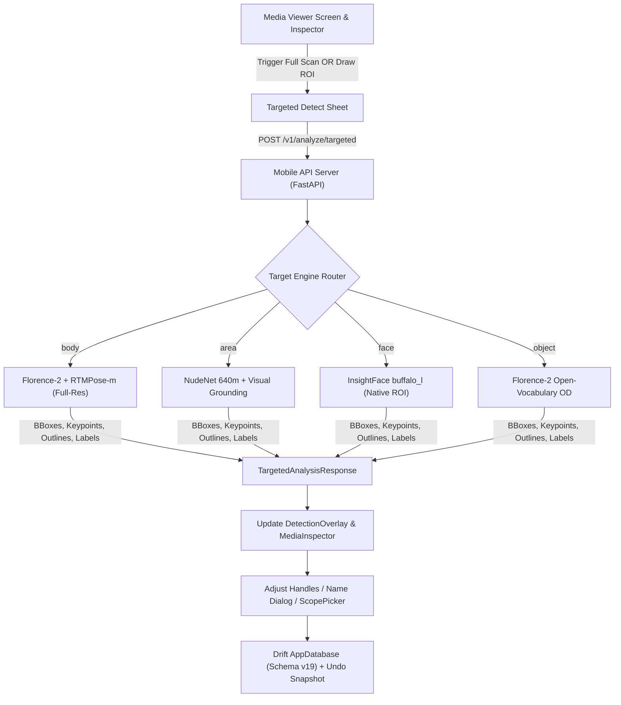

# Targeted Detection & In-Viewer Correction Design

## 1. Overview
This feature introduces high-accuracy on-demand detection and in-place correction directly within the media viewer for photos and videos.
Users can request targeted detection for:
- **Exposed Areas (`area`):** Any exposed skin or body region detected with high accuracy, returning exact contour outlines, leaving the user completely free to assign any custom name (e.g. "Chest", "Bikini Line", "Tattoo Patch", etc.) and associate it with a person.
- **Accurate Bodies (`body`):** Overcoming previous YOLOX 640 detection limitations using full-resolution multi-scale grounding with Florence-2 combined with RTMPose-m for 17 COCO keypoints.
- **Objects & Equipment (`object`):** Accurate detection of items, props, and equipment via Florence-2 open-vocabulary grounding.
- **Faces (`face`):** Native pixel-resolution evaluation on the selected Region of Interest (ROI) using InsightFace buffalo_l for small or profile faces.

Users can run detection on the full image or interactively draw an ROI box (`Draw Box`) directly on screen. All results can be adjusted (resize/drag handles), named, linked, and persisted with full Undo support. In videos, a `ScopePicker` applies corrections to the current frame, appearance track, or whole video.

---

## 2. Architecture & Data Flow

---

## 3. Server-Side Specifications (`the app/mobile_api`)

### Endpoint: `POST /v1/analyze/targeted`
- **Request Format:** Multipart Form-data
  - `image`: UploadFile (binary image bytes)
  - `target_kind`: Form string (`area` | `body` | `face` | `object`)
  - `roi`: Form string optional JSON `{"x": float, "y": float, "w": float, "h": float}` in normalized [0..1] coordinates
  - `prompt`: Form string optional (for open-vocabulary object/area search)
  - `high_res`: Form bool (default `true`)

### Engine Handlers:
1. **Body (`body`):**
   - High-resolution detection using Florence-2 (`<CAPTION_TO_PHRASE_GROUNDING>` with `"person . body"`) or YOLOX high-res patch.
   - Extracts bounding box, crops at native resolution, and passes to `RTMPose-m` to generate 17 keypoints and pose metrics.
   - Generates exact body contour outline.
2. **Exposed Area (`area`):**
   - Evaluates NudeNet 640m with adjusted detection threshold + Florence-2 visual grounding.
   - Computes morphological contour outline of the exposed skin patch.
   - Leaves label as raw reference while returning `suggested_label`.
3. **Object (`object`):**
   - Florence-2 open-vocabulary object detection (`<OD>`) with bounding box and label.
4. **Face (`face`):**
   - InsightFace `buffalo_l` detection on ROI with ArcFace 512 embedding and 5 landmarks.
5. **Fallback Safety:**
   - If no model detection meets threshold inside a user-drawn ROI, return a user-defined container with the exact ROI so the user can still name and keep it.

---

## 4. Mobile Client Specifications (`mobile/lib`)

### Components:
1. **Trigger:**
   - `MediaChromeBottomBar`: New `Detect` button with `Key('media-actions-detect')`.
   - `MediaInspector`: Action card "Targeted Detect" under File Info / AI Actions.
2. **Interactive Drawing & Box Editing:**
   - `RoiSelectionOverlay`: Draggable/resizable box on top of the media item with 8 control handles.
3. **Naming & Association Dialog:**
   - Instant bottom sheet on completion:
     - Area: Text input with suggestion chips + Person selector.
     - Body: Person selector / new person creation.
     - Object: Name field + owner link.
     - ScopePicker (Videos only): Segmented button for "This Frame", "This Track", "Whole Video".
4. **Persistence & Corrections:**
   - Saves to `AppDatabase` (Schema v19) tables: `Bodies`, `Faces`, `SensitiveRegions`, `EquipmentObjects`.
   - Records overrides in `BodyOverrides` / `FaceOverrides` so future automated scans do not wipe user-corrected detections.
   - Registers snapshot in `CorrectionService` for 8-second `UndoSnackbar`.

---

## 5. Testing & Verification

1. **Python Contract Tests:**
   - `test_targeted_analysis.py`: Verifies `POST /v1/analyze/targeted` responses for all 4 kinds with mock/sample images.
2. **Flutter Unit & API Tests:**
   - `targeted_api_test.dart`: DTO parsing, query parameter serialization, and error handling.
   - `targeted_detection_service_test.dart`: Database persistence, override generation, and undo restoration.
3. **Flutter Widget Tests:**
   - `targeted_detect_ux_test.dart`: Full UI journey from viewer click to ROI drawing, sheet submission, inspector update, and box handle resizing.
