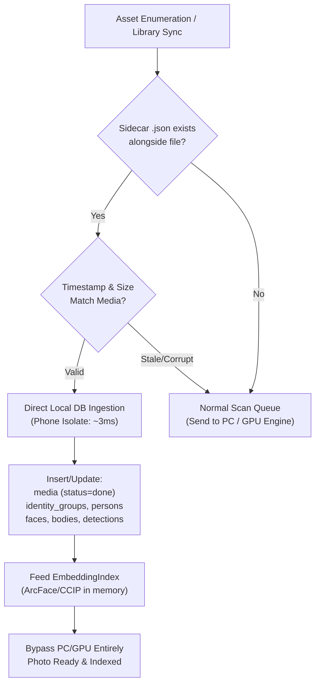

# Design Specification: Sidecar Metadata Persistence & Dynamic Auto-Organization

**Date:** 2026-11-03  
**Status:** Approved by User  
**Target Platform:** Mobile (`mobile/`, Flutter + SQLite/Drift + Android MediaStore)

---

## 1. Executive Summary & Goals

Users can organize original photos and videos of a person or group into dedicated public folders (`DCIM/Your Gallery/<Group>/<Person>/...`). This specification adds two critical capabilities to that existing organization system:

1. **Sidecar Metadata Persistence & Zero-Rescan Restoration:**
   - When files are moved to their organized destination, a 1:1 sidecar metadata file (`<filename>.<ext>.json`) is generated alongside the media file.
   - It captures all AI inference outputs (ArcFace/CCIP embeddings, facial landmarks, bounding boxes, pose keypoints, HSV outfit descriptors, Catmull-Rom outlines, and sensitive regions) along with person and group associations.
   - If the application is uninstalled, database cleared, or cache wiped, the next scan reading these organized folders ingests the sidecar files in milliseconds (`scan_status = 'done'`), completely eliminating the need for network transmission or GPU re-inference.

2. **Dynamic Auto-Organization (Live Re-Sync):**
   - Media movement is no longer a one-time static batch operation. Any identity or grouping mutation triggers immediate background synchronization of both the media file and its sidecar `.json`.
   - **Corrections & Reassignments:** If a detection is corrected or reassigned to a different person, the file and its sidecar move to the new person's folder. If unassigned, they move out to an unassigned/original directory.
   - **New Detections:** Newly scanned or assigned media belonging to an organized person automatically moves to their folder.
   - **Group Relocation:** Changing a person's group dynamically updates their parent directory (`DCIM/Your Gallery/<NewGroup>/<Person>/`).
   - **Master Person Architecture:** In multi-person photos, physical file location follows a designated **Master Person** (initially chosen by organization context or prominent face, with a 1-tap ⭐ override in Media Inspector), while the sidecar file retains metadata for all co-occurring persons.

---

## 2. Sidecar File Specification (`<filename>.<ext>.json`)

### 2.1 File Placement & Naming
For every organized media item:
```text
DCIM/Your Gallery/<Group>/<Person>/<Person>_image_0001.jpg
DCIM/Your Gallery/<Group>/<Person>/<Person>_image_0001.jpg.json
```

### 2.2 JSON Schema Contract
```json
{
  "version": 1,
  "asset_id": "10042",
  "media_info": {
    "kind": "photo",
    "width": 3024,
    "height": 4032,
    "duration_ms": 0,
    "taken_at": 1698765432000,
    "modified_at": 1698765440000,
    "is_sensitive": false
  },
  "ownership": {
    "group_id": 3,
    "group_name": "Family",
    "master_person_id": 12,
    "master_person_name": "Ahmed",
    "master_person_kind": "person"
  },
  "faces": [
    {
      "face_id": 412,
      "person_id": 12,
      "person_name": "Ahmed",
      "bbox": [0.35, 0.20, 0.25, 0.25],
      "quality": 0.89,
      "yaw": 4.2,
      "pitch": -2.1,
      "roll": 0.8,
      "embedding_model": "buffalo_l",
      "embedding": "<base64_encoded_512_floats>",
      "track_id": null
    },
    {
      "face_id": 413,
      "person_id": 15,
      "person_name": "Sara",
      "bbox": [0.65, 0.22, 0.22, 0.24],
      "quality": 0.86,
      "yaw": -3.5,
      "pitch": 1.1,
      "roll": -0.5,
      "embedding_model": "buffalo_l",
      "embedding": "<base64_encoded_512_floats>",
      "track_id": null
    }
  ],
  "bodies": [
    {
      "body_id": 801,
      "person_id": 12,
      "bbox": [0.28, 0.18, 0.40, 0.75],
      "keypoints": [[x1, y1, s1], "...17 COCO keypoints..."],
      "appearance": [0.12, 0.45, "...80 HSV floats..."],
      "extent": "full",
      "outline": [[px1, py1], "...Catmull-Rom polygon points..."]
    }
  ],
  "sensitive_regions": [],
  "equipment_objects": []
}
```

---

## 3. Zero-Rescan Restoration Architecture



1. **Asset Enumeration (`LibraryRepository.syncAssets`):**
   - When traversing MediaStore assets, checks if a companion `.json` exists in the same relative path.
   - If present and valid, routes directly to `SidecarIngestionService`.

2. **Local Ingestion Pipeline (`SidecarIngestionService`):**
   - Decodes JSON and base64 embedding vectors.
   - Ensures `IdentityGroup` and `Person` exist; if absent, creates them using persisted names and kinds.
   - Inserts records into `media`, `faces`, `bodies`, `media_detections`, and `sensitive_regions` in a single SQLite transaction.
   - Directly populates `EmbeddingIndex` with parsed float vectors for immediate face recognition and search.
   - Marks `media.scan_status = 'done'` with current `scanVersion`.

---

## 4. Dynamic Auto-Organization Engine

### 4.1 Master Person Resolution for Shared Media
- Each media item has a single physical folder owner: `master_person_id`.
- **Default Resolution:**
  1. If previously organized, the current folder owner remains Master unless explicitly changed or unassigned.
  2. For newly organized shared media, the person from whose screen the organization was launched is Master.
  3. Otherwise, the person with the largest bounding box / highest face quality is selected.
- **Manual Control:** In `MediaInspector`, a `Master ⭐` chip appears on the active owner's row. Tapping another detected person's overflow menu allows selecting `"Set as file master"`, triggering an immediate background move to that person's folder.

### 4.2 Auto-Sync Triggers
1. **Face / Detection Correction (`CorrectionService.apply`):**
   - Reassigning a detection from Person A to Person B updates the Master if Person A was the sole/master owner, migrating the media file + sidecar to Person B's directory.
   - Marking "Not this person" or "Unassigned" removes the person. If no organized owner remains, moves the file to an unassigned holding path (`DCIM/Your Gallery/Unsorted/`).
2. **New Media Assignment (`PhotoResultStore.store` / Manual Link):**
   - When a newly scanned or manually assigned photo belongs to an organized person, auto-moves the file into their folder and creates its sidecar.
3. **Group Relocation (`PeopleRepository.setPersonGroup`):**
   - Moving a person to a new group triggers a folder path relocation for all their physical media items.

### 4.3 Move Execution & Safety
- **Atomic Two-File Movement:** The media file is updated via MediaStore (`RELATIVE_PATH`), and the companion `.json` is written/moved to match.
- **Journaling:** Tracked in Drift table `person_media_moves` (`pending` -> `moved`), ensuring crash resilience and reconciliation upon restart.
- **Collision Protection:** Suffixes `_m<mediaId>` prevent accidental overwrite of existing files.

---

## 5. UI Integration

1. **Media Inspector (`mobile/lib/features/inspector/media_inspector.dart`):**
   - Primary owner displays a subtle badge: `"Master ⭐"`.
   - Action item on other detected persons: `"Set as primary file owner"`.
2. **Library Settings (`mobile/lib/features/settings/library_settings_screen.dart`):**
   - Toggle: `"Auto-sync organized folders"` (default: `true`).
   - Toggle: `"Save sidecar metadata (.json)"` (default: `true`).

---

## 6. Verification & Test Plan

1. **Unit Tests:**
   - `sidecar_format_test.dart`: Serialization/deserialization of full detection trees with base64 embeddings.
   - `sidecar_ingestion_test.dart`: Ingesting sidecar into fresh in-memory database without network calls; verifies `EmbeddingIndex` and database rows.
   - `master_person_resolution_test.dart`: Single vs multi-person owner resolution and manual switch.
   - `dynamic_organizer_test.dart`: Media and sidecar move upon face reassignment, unlinking, and group change.
2. **Regression Tests:**
   - Existing `organize_media_screen_test.dart`, `people_test.dart`, `schema_v19_test.dart`.
3. **Static Analysis:**
   - `dart analyze lib test` reports 0 issues.
